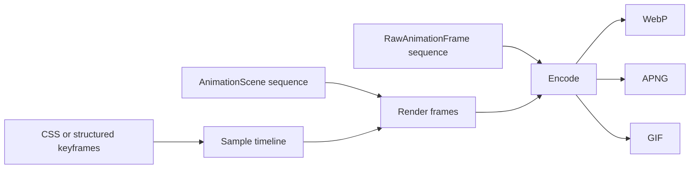

# Animation

The animation API supports two models: sampling CSS or structured keyframes at a
specific time, and encoding a sequence of scenes or raw frames.



## Timeline sampling

`time_ms` selects the instant at which CSS animations are sampled. Keyframes come from
`@keyframes` rules in a stylesheet or from the structured `keyframes` option:

=== "CSS keyframes"

    ```python
    from takumi_py import Renderer

    frame = Renderer().render_html(
        '<div class="box"></div>',
        stylesheets=[
            """
            @keyframes fade {
              from { opacity: 0; }
              to { opacity: 1; }
            }
            .box {
              width: 64px;
              height: 64px;
              background: black;
              animation: fade 1000ms both;
            }
            """
        ],
        width=64,
        height=64,
        time_ms=500,
    )
    ```

=== "Structured keyframes"

    ```python
    from takumi_py import Renderer

    frame = Renderer().render_node(
        {"type": "container", "className": "box"},
        stylesheets=[
            ".box { width: 64px; height: 64px; animation: fade 1000ms both; }",
        ],
        keyframes={
            "fade": {
                "from": {"opacity": 0},
                "to": {"opacity": 1},
            }
        },
        width=64,
        height=64,
        time_ms=500,
    )
    ```

`RenderOptions(keyframes=...)` carries the same structured keyframes, so a reusable
options value can hold the animation definition alongside `time_ms`.

## Scene sequences

`render_animation` accepts a sequence of `AnimationScene` values, each a node with a
duration. The `format` argument selects WebP, APNG, or GIF, while `fps` controls how
often the timeline is sampled:

```python
from takumi_py import AnimationScene, Renderer

animation = Renderer().render_animation(
    [
        AnimationScene(
            {
                "type": "container",
                "style": {
                    "width": "100%",
                    "height": "100%",
                    "backgroundColor": "black",
                },
            },
            duration_ms=200,
        ),
        AnimationScene(
            {
                "type": "container",
                "style": {
                    "width": "100%",
                    "height": "100%",
                    "backgroundColor": "white",
                },
            },
            duration_ms=200,
        ),
    ],
    width=64,
    height=64,
    fps=20,
    format="webp",
)
```

`render_animation` streams each frame into the encoder as it renders, so it holds one
raw frame at a time rather than the whole animation. To render a single frame of a
sequence instead, call `render_sequence_at_time(scenes, time_ms)`, which returns a
static image in any raster format.

## Raw frames

Use `encode_frames` with `RawAnimationFrame` values when frames are produced elsewhere,
for example by `format="raw"` renders or another image library:

```python
from takumi_py import RawAnimationFrame, Renderer

black = bytes([0, 0, 0, 255] * 4)
white = bytes([255, 255, 255, 255] * 4)

gif = Renderer().encode_frames(
    [
        RawAnimationFrame(black, width=2, height=2, duration_ms=100),
        RawAnimationFrame(white, width=2, height=2, duration_ms=100),
    ],
    format="gif",
)
```

## Contracts

- Every `AnimationScene.duration_ms` and `RawAnimationFrame.duration_ms` must be a
  positive integer. Zero-duration scenes or frames raise `ValueError` rather than being
  silently skipped.
- `fps` must be positive and must not exceed the delay precision of the selected
  format: WebP and APNG support at most 90 fps, while GIF supports at most 50 fps.
  `render_animation` raises `ValueError` before rendering when `fps` is higher.
- `webp_speed`, when provided, must be an integer from 0 through 6.
- A raw frame must have positive dimensions and exactly `width * height * 4` RGBA bytes.
- `loop_count` sets the number of repetitions; `None` keeps the format's default.

!!! note "WebP defaults to lossless"

    WebP animation defaults to lossless when neither `quality` nor `lossless` is
    specified. `quality` and `lossless=True` are mutually exclusive.

See the runnable
[`examples/render_animation.py`](https://github.com/BalconyJH/takumi-py/blob/main/examples/render_animation.py)
example.
