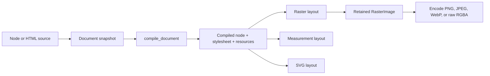

# Documents and reusable outputs

!!! info "Next-major preview"

    `Document`, `CompiledDocument`, `Fragment`, `ResourceSet`, `RasterImage`, and the
    new `Renderer.render`, `Renderer.rasterize`, `Renderer.measure`, and
    `Renderer.render_svg` entry points are a next-major preview in this checkout.
    They are additive: the package metadata and version remain unchanged, and the
    existing `render_*`, `measure_*`, and `render_svg_*` APIs remain compatible.

The document API groups a rendered input with the resources it owns, then separates
compilation from output. It is useful when the same content is rendered as a raster
image, measured, and rendered as SVG, especially when image bytes must travel with the
document.

The APIs are implemented by the native Python package. They do not start a JavaScript
runtime, require Node.js, load an external sidecar, or fetch remote resources.

## Pipeline { #pipeline }



`Document.from_node` and `Document.from_html` create immutable source snapshots.
`compile_document` parses the node or HTML, compiles and merges stylesheets, and
returns a `CompiledDocument` containing:

| Component | Purpose |
| --- | --- |
| `node` | Native `CompiledNode` |
| `stylesheets` | Zero or one merged native stylesheet |
| `resources` | Immutable `ResourceSet` plus an opaque native encoded-resource snapshot |

`Renderer.render`, `Renderer.rasterize`, `Renderer.measure`, and
`Renderer.render_svg` accept either a `Document` or a `CompiledDocument`. Passing a
raw `Document` compiles it for that call. Call `compile_document` first when
compilation should be reused.

!!! warning "A compiled document does not own layout"

    A `CompiledDocument` owns parsed source and resources, not a precomputed layout,
    paint tree, or pixel buffer. Every output call lays out the compiled node again.
    Layout options, animation time, media resolution, and raster scale can therefore
    produce different geometry or pixels from the same compiled document. Call
    `Renderer.rasterize` when the drawn pixels themselves should be reused. Its
    returned `RasterImage` owns the layout result, and repeated `encode` calls reuse
    that bitmap without laying out or drawing the document again.

`compile_document` copies encoded image bytes once into its opaque native resource
snapshot. The document render methods borrow that snapshot, so later renders do not
upload the same data from Python to Rust again. This is not zero-copy:
`ResourceSet` validation and document snapshots still own copied bytes. Decoding a
resource remains renderer-local and follows that renderer's resource cache.

## Create a document { #create-a-document }

### Node documents { #node-documents }

`Document.from_node` accepts a node mapping and snapshots it. Node documents compile
CSS strictly, so invalid stylesheet syntax raises `StyleSheetError`.

```python
from pathlib import Path

from takumi_py import (
    Document,
    Fragment,
    ImageResource,
    LayoutOptions,
    RasterOptions,
    Renderer,
    ResourceSet,
    compile_document,
)

logo = Fragment(
    {
        "type": "image",
        "src": "memory://logo",
        "width": 32,
        "height": 32,
    },
    ResourceSet(
        [
            ImageResource("memory://logo", Path("logo.svg").read_bytes()),
        ]
    ),
)

document = Document.from_node(
    {
        "type": "container",
        "className": "card",
        "children": [
            logo,
            {"type": "text", "text": "Reusable document"},
        ],
    },
    stylesheets=[
        ".card { padding: 24px; color: black; }",
    ],
)

compiled = compile_document(document)
renderer = Renderer()

png = renderer.render(
    compiled,
    layout=LayoutOptions(width=320, height=160),
    output=RasterOptions(scale=2),
)
```

The stylesheet strings are applied in order. Structured `keyframes` passed to either
document constructor are compiled after those stylesheets. A document snapshot keeps
defensive copies of mutable node, stylesheet, keyframe, and resource inputs.

### HTML documents { #html-documents }

`Document.from_html` keeps the HTML string plus explicitly supplied resources and
stylesheets. The native parser handles HTML structure, extracts eligible `<style>`
elements, and applies the configured style presets. Explicit author stylesheets remain
available and are applied before the document's extracted styles. HTML documents use
Takumi's lossy CSS parser because browser-authored stylesheets commonly contain
declarations the renderer does not support.

```python
from pathlib import Path

from takumi_py import (
    Document,
    HtmlOptions,
    ImageResource,
    LayoutOptions,
    Renderer,
    compile_document,
)

document = Document.from_html(
    '<article class="story"><p>Read me</p></article>',
    resources=[
        ImageResource("memory://cover", Path("cover.webp").read_bytes()),
    ],
    stylesheets=[
        ".story { padding: 24px; }",
        "@media (min-width: 600px) { .story { padding: 48px; } }",
    ],
    html_options=HtmlOptions(presets="chromium"),
)

compiled = compile_document(document)
renderer = Renderer()

svg = renderer.render_svg(
    compiled,
    layout=LayoutOptions(width=640, height=360),
)
```

HTML parsing does not fetch image bytes, Markdown, formulas, or linked external
stylesheets. Pass every image resource explicitly. Eligible embedded `<style>` CSS is
collected automatically; put additional author CSS in `stylesheets`.

### Fragments and resources { #fragments-and-resources }

`Fragment` pairs a reusable node value with a `ResourceSet`. When a `Document` is
created, it walks the node tree, expands every fragment in place, snapshots the
expanded node, and appends the fragment resources to the document. The same fragment
can appear repeatedly without duplicating identical resources.

Fragments passed to `Document.from_node` must contain node mappings. A generic
`Fragment` can hold other values, but a `CompiledNode` fragment cannot be expanded
into a source document; use the compiled-node APIs for an already compiled tree.

`ResourceSet` preserves first-seen order and copies resource bytes. Exact duplicates
with the same `src`, bytes, and cache mode are collapsed. If one `src` maps to
different bytes or a different cache mode, construction raises `ResourceError`.

```python
from takumi_py import ImageResource, ResourceError, ResourceSet

try:
    resources = ResourceSet(
        [
            ImageResource("memory://logo", b"first image"),
            ImageResource("memory://logo", b"different image"),
        ]
    )
except ResourceError as error:
    print(error)
```

Resources attached to fragments and resources passed to `Document.from_node` share
the same namespace. A conflict anywhere in the assembled document is an error rather
than a last-one-wins choice.

## Add resources after compilation { #add-resources }

`CompiledDocument.with_resources()` extends a compiled document without parsing its
node or stylesheets again. The original value remains unchanged, and the returned
document shares its native node and stylesheet handles.

```python
from takumi_py import Document, ImageResource, compile_document

logo = b"""
<svg xmlns="http://www.w3.org/2000/svg" width="16" height="16">
  <rect width="16" height="16" fill="#38bdf8"/>
</svg>
"""

compiled = compile_document(
    Document.from_node(
        {
            "type": "image",
            "src": "https://assets.example/logo.svg",
            "width": 16,
            "height": 16,
        }
    )
)
assert compiled.missing_resources() == ("https://assets.example/logo.svg",)

enriched = compiled.with_resources(
    [ImageResource("https://assets.example/logo.svg", logo)]
)
assert enriched.missing_resources() == ()
assert enriched.node is compiled.node
assert enriched.stylesheets is compiled.stylesheets
assert compiled.missing_resources() == ("https://assets.example/logo.svg",)
```

Resources keep their first-seen order. Adding an identical resource is a no-op and
may return the same compiled document. A different byte buffer or cache policy for an
existing `src` raises `ResourceError`. `ResourceSet.merged()` provides the same
immutable merge behavior before compilation.

## Compile once, lay out per output { #compile-once }

Compilation is deterministic with respect to the source and options captured by the
`Document`. The same `CompiledDocument` can be reused across renderers and outputs.

```python
from takumi_py import Document, LayoutOptions, RasterOptions, Renderer, compile_document

compiled = compile_document(
    Document.from_node(
        {
            "type": "container",
            "style": {"width": "160px", "height": "80px", "backgroundColor": "black"},
        }
    )
)

renderer = Renderer()
layout = LayoutOptions(width=240, height=120)

png = renderer.render(compiled, layout=layout, output=RasterOptions(format="png"))
raw = renderer.render(compiled, layout=layout, output=RasterOptions(format="raw"))
measured = renderer.measure(compiled, layout=layout)
svg = renderer.render_svg(compiled, layout=layout)
```

Each call above lays out the content independently. This is intentional: measurement
always uses a device pixel ratio of one, SVG uses CSS-pixel dimensions, and raster
output may use another scale. Image resources are available through the document, but
decoded images remain renderer-local and follow each renderer's resource-cache policy.
`Renderer.render` is the one-call convenience for callers that need only the finished
bytes.

## Reuse a raster result { #reuse-a-raster-result }

`Renderer.rasterize` returns an immutable `RasterImage` with tightly packed,
straight-alpha RGBA8 pixels. The renderer and source document may be released after
this call; the image owns its native bitmap and remains usable.

```python
from takumi_py import Document, LayoutOptions, Renderer, compile_document

compiled = compile_document(
    Document.from_node(
        {
            "type": "container",
            "style": {
                "width": "240px",
                "height": "120px",
                "backgroundColor": "#0f172a",
            },
        }
    )
)

image = Renderer().rasterize(
    compiled,
    layout=LayoutOptions(width=240, height=120),
    scale=2,
)

png = image.encode("png")
jpeg = image.encode("jpeg", quality=90)
webp = image.encode("webp", quality=85)
rgba = image.tobytes()

assert image.size == (480, 240)
assert len(rgba) == image.nbytes == image.stride * image.height
```

Only the `rasterize` call lays out and draws. The encoder calls above read the same
retained bitmap. `image.data` and `image.tobytes()` copy its pixels into Python-owned
bytes. `image.to_raw_source()` returns a `RawRgbaImage` mapping, and
`image.to_fragment()` wraps that mapping in a `Fragment` that can be composed into
another document. Both conversion methods copy the pixel buffer into the new document
snapshot.

## Layout in CSS pixels { #layout-in-css-pixels }

`LayoutOptions` describes the document viewport in CSS pixels:

| Field | Default | Meaning |
| --- | --- | --- |
| `width` | `1200` | Canvas width in CSS pixels, or `None` to infer it |
| `height` | `None` | Canvas height in CSS pixels, or `None` to infer it |
| `font_size` | `16.0` | Root font size used for `rem` and fallback metrics |
| `time_ms` | `0` | Animation sampling time |
| `font_families` | `None` | Preferred fallback family order |
| `lang` | `None` | BCP-47 language used for shaping and line breaking |

Explicit dimensions must be positive 32-bit integers. `font_size` must be a finite,
positive native float. `time_ms` must be a non-negative signed 64-bit integer.

The same requested layout dimensions are used by `render`, `measure`, and `render_svg`.
Viewport media queries such as `width`, `height`, `orientation`, and `aspect-ratio`
use the effective CSS dimensions, including the raster rounding described below.
A raster call additionally uses `RasterOptions.scale` as its device
pixel ratio, so `resolution` media queries can differ between raster output and
measurement or SVG even when `LayoutOptions` is unchanged.

## Raster output and scale { #raster-output-and-scale }

`RasterOptions` configures the one-call `Renderer.render` helper. It has no effect on
`rasterize`, `measure`, or `render_svg`.

| Field | Default | Meaning |
| --- | --- | --- |
| `format` | `"png"` | `"png"`, `"jpeg"`, `"jpg"`, `"webp"`, `"ico"`, or `"raw"` |
| `scale` | `1.0` | Output pixels per CSS pixel |
| `quality` | `None` | Lossy encoder quality from 0 through 100 |
| `lossless` | `None` | Lossless WebP encoding |
| `dithering` | `"none"` | Dithering mode |
| `draw_debug_border` | `False` | Draw layout debug borders |

`scale` multiplies the explicit CSS dimensions to choose the output canvas. For
example, a 1200×630 CSS layout at scale 2 produces a 2400×1260 raster. An inferred
dimension remains inferred and is scaled from the resulting content size.

Fractional scales are allowed. Each explicit output dimension is rounded up with
`ceil(width * scale)` and `ceil(height * scale)`; avoid asserting exact fractional
pixel geometry from the output canvas alone. A scaled dimension that exceeds the
native 32-bit limit raises `ValueError`.

The native raster viewport is reconstructed from the rounded canvas and scale. For
example, width 41 at scale 1.5 becomes 62 output pixels and an effective CSS width
of approximately 41.333. This can change viewport units and media-query matches near
a breakpoint, including width, height, aspect ratio, and orientation. Use a scale
that maps explicit dimensions to whole output pixels when matching measurement or
SVG layout at a breakpoint matters.

```python
import struct

from takumi_py import Document, LayoutOptions, Renderer, RasterOptions, compile_document

compiled = compile_document(
    Document.from_node(
        {
            "type": "container",
            "style": {"width": "1200px", "height": "630px"},
        }
    )
)

png = Renderer().render(
    compiled,
    layout=LayoutOptions(width=1200, height=630),
    output=RasterOptions(format="png", scale=1.5),
)

assert struct.unpack(">II", png[16:24]) == (1800, 945)
```

For a retained bitmap, pass `scale`, `dithering`, and `draw_debug_border` directly to
`Renderer.rasterize`. Choose an output format later through `RasterImage.encode`;
those encoder choices do not change the bitmap or rerun layout.

## Legacy pixel sizing { #legacy-pixel-sizing }

The existing APIs remain supported with their current semantics. Their `width` and
`height` arguments are output pixel dimensions; `device_pixel_ratio` changes the CSS
viewport and media resolution inside that fixed raster. The document API reverses the
axis: `LayoutOptions` sets CSS pixels first, then `RasterOptions.scale` chooses output
pixels.

```python
from takumi_py import (
    Document,
    LayoutOptions,
    RasterOptions,
    Renderer,
    compile_document,
)

legacy = Renderer().render_html(
    "<div>Hello</div>",
    width=1200,
    height=630,
    device_pixel_ratio=2,
)

document = Document.from_node({"type": "text", "text": "Hello"})
new_api = Renderer().render(
    compile_document(document),
    layout=LayoutOptions(width=1200, height=630),
    output=RasterOptions(scale=2),
)
```

The legacy render above keeps a 1200×630 output canvas. The document render produces
a 2400×1260 canvas because 1200×630 are CSS dimensions. Keep using the legacy methods
when callers already express dimensions in output pixels; do not convert them
silently.

## Validation and failures { #validation-and-failures }

Document construction and compilation surface errors at the layer that can explain
them:

| Failure | Exception |
| --- | --- |
| Conflicting image data or cache mode for one `src` | `ResourceError` |
| Invalid node mapping during compilation | `NodeDecodeError` |
| Invalid HTML or parser depth | `HtmlParseError` |
| Invalid strict node CSS or structured keyframes | `StyleSheetError` |
| Invalid layout/output numeric option | `ValueError` |
| Invalid raw bitmap dimensions, overflow, or byte count | `ValueError` |
| Rendering, image decoding, or encoding failure | Native render exception |

Passing a `CompiledDocument` avoids recompilation but does not bypass layout-time
validation or output encoding checks. A renderer still resolves images, selects
fonts, evaluates media queries at the requested viewport and scale, performs layout,
and encodes the requested output. In contrast, `RasterImage.encode` validates encoder
arguments and reuses pixels that have already passed those layout and paint stages.

## API reference { #api-reference }

The complete generated signatures for the new document APIs are on the
[Renderer API page](../reference/api/renderer.md#document-apis). Existing signatures
remain available there as well.

The runnable
[`examples/render_static.py`](https://github.com/BalconyJH/takumi-py/blob/main/examples/render_static.py)
demonstrates a template-to-document pipeline, resource discovery, one raster layout,
and multiple encodings.
