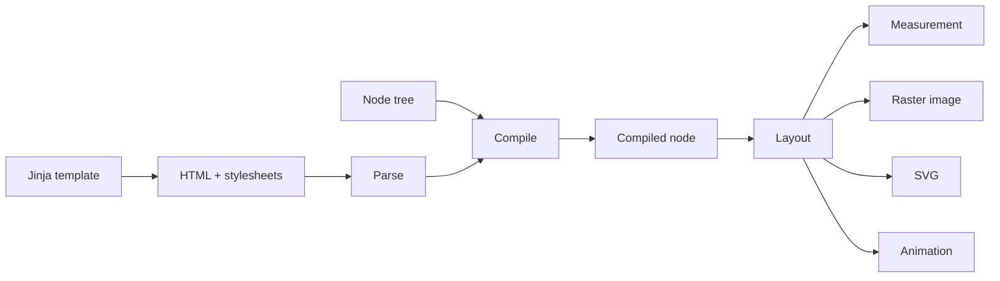

# Rendering model

`Renderer` follows one pipeline regardless of the source representation:



This page covers the stages every input shares: choosing an input, compiling it, and
configuring a render. [HTML and CSS](html.md) covers parsing, and
[Output formats](output.md) covers what a render produces.

## Choose an input

| Input | Entry points | Guide |
| --- | --- | --- |
| Node tree | `render_node`, `measure_node`, `render_svg_node` | [Node trees](#node-trees) |
| HTML | `render_html`, `measure_html`, `render_svg_html` | [HTML and CSS](html.md) |
| Jinja template | `render_template`, `render_svg_template`, `TemplateRenderer` | [Jinja templates](templates.md) |
| Compiled node | `render_compiled`, `measure_compiled`, `render_svg_compiled` | [Compile and reuse](#compile-and-reuse) |
| Scene sequence | `render_animation`, `render_sequence_at_time` | [Animation](animation.md) |

## Node trees

A node tree is a mapping with a `type` of `"container"`, `"text"`, or `"image"`. Styles
use camel-cased CSS property names, and containers nest children:

```python
from takumi_py import Renderer

png = Renderer().render_node(
    {
        "type": "container",
        "style": {
            "width": "320px",
            "height": "160px",
            "display": "flex",
            "alignItems": "center",
            "justifyContent": "center",
            "backgroundColor": "white",
        },
        "children": [
            {"type": "text", "text": "Hello", "style": {"fontSize": "48px"}},
        ],
    },
    width=320,
    height=160,
)
```

Every node also accepts `className`, `id`, `tagName`, and `attributes` for selectors,
`tw` for Tailwind classes, and `dir` and `lang` metadata. `TextNode`, `ImageNode`, and
`ContainerNode` describe these shapes for type checkers.

Pass `validate=True` to a node entry point to check the mapping in Python before it
reaches the native decoder. Validation raises `NodeValidationError`; without it, a
malformed node raises `NodeDecodeError` from the decoder.

## Compile and reuse

For one render, call `render_node` or `render_html` directly. When the same content is
rendered repeatedly, move parsing and stylesheet compilation out of the hot path:

```python
from takumi_py import Renderer

renderer = Renderer()
compiled = renderer.compile_node({"type": "text", "text": "Reusable"})
stylesheet = renderer.compile_stylesheet("span { font-size: 32px; }")

png = renderer.render_compiled(
    compiled,
    stylesheets=[stylesheet],
    width=320,
    height=160,
)
```

`compile_html` returns a `CompiledHtml` bundle rather than a bare `CompiledNode`. Pass
its node and stylesheets separately to the compiled APIs, and compile any
document-level CSS before adding it to that stylesheet tuple:

```python
from takumi_py import Renderer

renderer = Renderer()
compiled = renderer.compile_html('<div class="card">Reusable HTML</div>')
stylesheets = (
    *compiled.stylesheets,
    renderer.compile_stylesheet(".card { width: 320px; height: 160px; color: black; }"),
)

png = renderer.render_compiled(
    compiled.node,
    stylesheets=stylesheets,
    width=320,
    height=160,
)
```

Do not pass the `CompiledHtml` wrapper itself to `render_compiled` or
`measure_compiled`; those methods accept `CompiledNode`.

## Render options

Every render setting is a keyword argument. `RenderOptions` groups the same settings
into one reusable value:

```python
from takumi_py import RenderOptions, Renderer

options = RenderOptions(
    width=None,
    height=None,
    format="raw",
    device_pixel_ratio=2.0,
    dithering="ordered-bayer",
)

raw = Renderer().render_node(
    {
        "type": "container",
        "style": {
            "width": "240px",
            "height": "120px",
            "backgroundColor": "white",
        },
    },
    options=options,
)
```

An explicit keyword argument overrides the matching `RenderOptions` field for that call,
so `render_node(node, options=options, format="png")` keeps every other field of
`options`. The binding still rejects contradictory combinations, such as a lossy
`quality` together with `lossless=True`.

## Viewport

The default viewport is 1200×630. Pass `width=None` or `height=None` to infer that
dimension from layout. Fix both dimensions when output must be repeatable across calls.

## Parameter contracts

The native boundary validates values before rendering:

| Parameter | Contract |
| --- | --- |
| `width`, `height` | `None` for layout inference, otherwise a positive integer |
| `font_size` | Finite number greater than zero |
| `device_pixel_ratio` | Finite number greater than zero |
| `time_ms` | Non-negative integer |
| render-level `lang` | `None` or a valid BCP-47 language tag |
| `quality` | Integer from 0 through 100 |
| `lossless` | Supported only for WebP; `lossless=True` cannot be combined with `quality` |
| `dithering` | `"none"` or `"ordered-bayer"`; `"floyd-steinberg"` is a deprecated alias of `"ordered-bayer"` |

Invalid numeric values and contradictory encoder options raise `ValueError`. Format
names the binding does not recognize raise the format or animation exception described
in the [exception reference](../reference/exceptions.md).

See the runnable
[`examples/render_node.py`](https://github.com/BalconyJH/takumi-py/blob/main/examples/render_node.py)
and
[`examples/render_options_measure.py`](https://github.com/BalconyJH/takumi-py/blob/main/examples/render_options_measure.py)
examples.
