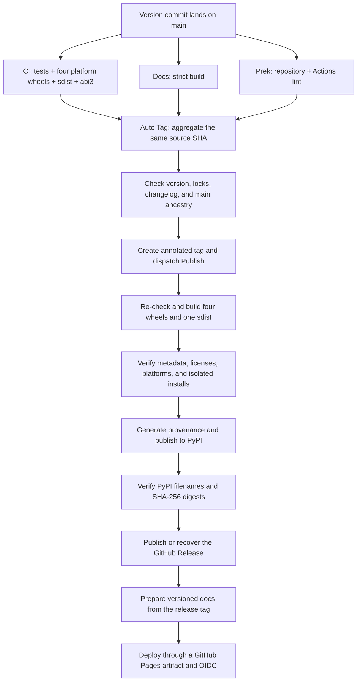

# Releasing

A version change on `main` drives every normal release. Maintainers do not build
artifacts, create tags, or deploy documentation by hand; automation only processes a
version that satisfies both the version contract and the exact-commit gates.

## Prepare the release commit

A release commit must satisfy every part of this contract:

- The project versions in `pyproject.toml` and the root `Cargo.toml` match exactly.
- The project version strictly increases over the first parent on `main` and uses the
  canonical PEP 440 form.
- `uv.lock` and `Cargo.lock` are up to date and pass the locked checks.
- `CHANGELOG.md` contains a dated heading for the version.
- `make check`, `make docs-build`, and every Prek hook pass.

Update versions with the project tools rather than editing the version fields directly:

```bash
uv version 0.3.0 --no-sync
cargo set-version 0.3.0
```

After the commit merges into `main`, `CI`, `Docs`, and `Prek` each verify that same
commit. `Auto Tag on Version Change` waits for all three workflows to succeed, confirms
the version, lock files, changelog, and ancestry on `main`, creates an annotated
`v0.3.0` tag on the commit, and dispatches `Publish` exactly once.

!!! note "Normal releases no longer create tags by hand"

    The automatic tag is part of the exact-commit gate. A manual tag skips the gate
    aggregation and is reserved for recovery an administrator has explicitly approved;
    do not run `git tag` or `Publish` directly for a normal release.

## Automatic release pipeline { #automatic-release-pipeline }



A release build produces four `cp310-abi3` wheels, for Linux x86_64, Linux aarch64,
macOS arm64, and Windows x64, plus one sdist. The verification layer:

1. Checks the complete artifact set, package metadata, licenses, ABI and platform tags,
   and the bundled-font boundary.
2. Installs each artifact into a temporary virtual environment outside the repository
   and runs a rendering smoke test, so nothing imports from the checkout by accident.
3. Rebuilds a wheel from the sdist and runs the same isolated smoke test on the result.
4. Generates GitHub build provenance for the files that are finally uploaded.
5. Uploads to PyPI through Trusted Publishing. A rerun may skip files that already
   exist, but the result must then match the complete file set and SHA-256 digests in
   the PyPI JSON exactly.
6. Publishes the GitHub Release only after the PyPI check succeeds. An existing
   published Release only allows an idempotent rerun with matching digests, and an
   existing draft can be recovered with the artifacts this run verified.
7. Updates the documentation version from the same release tag with mike. Only a
   release no older than the newest deployed version moves `latest`, and concurrent
   writes to the `gh-pages` branch, which stores the version state, retry a bounded
   number of times.
8. Exports the full static tree from the updated `gh-pages`, uploads a standard
   `github-pages` artifact, and deploys it through OIDC to the protected
   `github-pages` environment.

To check release artifacts locally, run:

```bash
make build-artifacts
```

The target builds the current platform's wheel and sdist, runs the Twine metadata check,
and verifies the wheel and the sdist rebuild path in isolated environments.
`DIST_SMOKE_PYTHON` selects the Python version the smoke test uses.

## External repository settings

Repository files cannot enable the following controls; an administrator configures them
on GitHub and PyPI:

- Protect `main`, requiring at least `CI / Required checks`,
  `Docs / Build docs strictly`, and `Prek / Repository hooks`, plus code-owner review of
  the release automation.
- Allow the GitHub Actions `GITHUB_TOKEN` to receive the write permissions the workflows
  declare. If release tags are protected, configure a controlled bypass for
  `Auto Tag on Version Change`.
- Configure required reviewers on the `release` environment.
- Bind the PyPI Trusted Publisher to owner `BalconyJH`, repository `takumi-py`, workflow
  `publish.yml`, and environment `release`.
- Set the GitHub Pages source to `GitHub Actions`, and let the `github-pages`
  environment deploy only from trusted `v*` release tags.
- Enable immutable GitHub Releases; the workflow only verifies digests of a published
  Release and never rewrites it.
- Keep the weekly Dependabot updates for GitHub Actions, and route SHA pin updates
  through the same gates.

## Failure recovery

=== "A gate failed before the tag was created"

    Fix the problem and merge the fix into `main`. Because the fix commit may keep the
    parent's version, automatic detection will not treat it as a version change again.
    Run `Auto Tag on Version Change` by hand from the current `main`, passing the full
    40-character `source_sha` of the current commit. Recovery mode only accepts the
    current `main` and still requires all three exact-commit workflows to succeed.

=== "The tag exists, but Publish did not succeed"

    Run `Publish` by hand from the matching tag or the default branch, passing the same
    `release_tag`. Do not create a replacement tag or move the existing one.

=== "PyPI already accepted some or all files"

    Rerun `Publish` for the same tag. The upload step uses `skip-existing`, and the
    digest check that follows confirms that existing files are the ones this run built.
    Missing files wait for PyPI metadata to converge; a digest mismatch fails at once.

=== "The GitHub Release or docs deployment failed"

    Run `Publish` again for the same tag. A published Release is reused only when its
    file set and digests match exactly, and a draft can be recovered from the verified
    artifacts. Docs preparation reads the remote `gh-pages` again and retries conflicts,
    and the Pages deployment that follows reuses the static artifact uploaded by the
    same run.

!!! danger "Never rewrite published artifacts"

    PyPI files, published GitHub Releases, and release tags are immutable inputs. Any
    digest mismatch should stop the release for investigation, rather than a force
    push, a replacement version, or an overwritten file.
