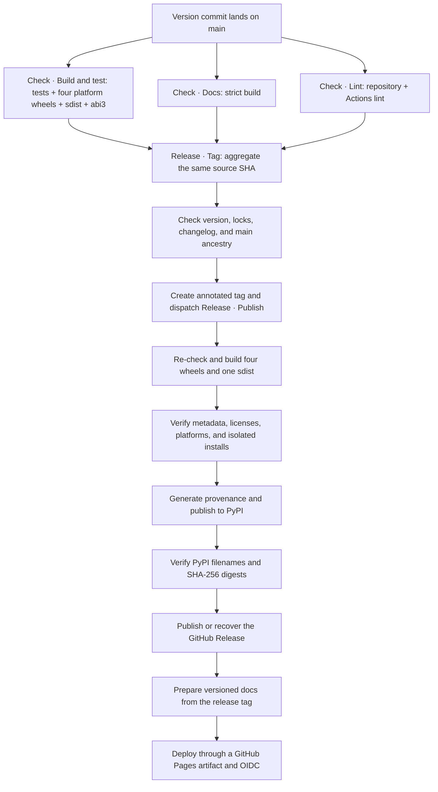

# Releasing

A version change on `main` drives every normal release. Maintainers do not build
artifacts, create tags, or deploy documentation by hand; automation only processes a
version that satisfies both the version contract and the exact-commit gates.

## Prepare the release commit

A release commit must satisfy every part of this contract:

- `pyproject.toml` holds a final version, `X.Y.Z`, or a prerelease of one: `X.Y.ZaN`,
  `X.Y.ZbN`, or `X.Y.ZrcN`. The root `Cargo.toml` holds its SemVer spelling, such as
  `0.4.0-rc.1` for `0.4.0rc1`.
- The project version strictly increases over the first parent on `main`.
- `uv.lock` and `Cargo.lock` are up to date and pass the locked checks.
- `CHANGELOG.md` has a dated section for the version, with the commit list
  `make changelog` generates.
- `make check`, `make docs-build`, and every Prek hook pass.

Prepare all of it with one target:

```bash
make release VERSION=0.4.0
```

It sets the version in `pyproject.toml`, `Cargo.toml`, and both lock files with
`.github/scripts/set-version.py`, writes the changelog entry with `make changelog`, and
checks the result with `.github/scripts/validate-release.py --version`, the check
`Release · Tag` runs before it tags. Review the diff and commit it as the release commit.

### Changelog entry

Curate user-facing notes under `## [Unreleased]` in `CHANGELOG.md` as changes land,
in Keep a Changelog sections. `make changelog` turns them into the release entry:

- It dates `[Unreleased]` as the project version and opens a new, empty
  `[Unreleased]` above it.
- It appends a **Commits** list that git-changelog builds from the conventional commits
  since the previous tag: breaking changes first, then one group per commit type, each
  commit linked by its short hash.
- It ends the entry with a link to the full diff and a **Contributors** line that
  @-mentions every author, co-author, and committer, except GitHub's own merge
  committer.

Logins come from GitHub noreply addresses, or from `gh api` for other emails, so run
the target with `gh` authenticated. Passing `--offline` to
`.github/scripts/changelog.py release` lists those people by name instead. Preview the
entry with `make changelog-preview VERSION=0.3.0`, edit its curated part if needed, and
commit it with the version bump.

The release workflow publishes that section verbatim as the GitHub Release notes.
Merge the release pull request with a merge commit: a squash or rebase merge rewrites
the hashes the entry links to.

After the commit merges into `main`, `Check · Build and test`, `Check · Docs`, and
`Check · Lint` each verify that same commit. `Release · Tag` waits for all three
workflows to succeed, confirms the version, lock files, changelog, and ancestry on
`main`, creates an annotated `v0.3.0` tag on the commit, and dispatches
`Release · Publish` exactly once.

!!! note "Normal releases no longer create tags by hand"

    The automatic tag is part of the exact-commit gate. A manual tag skips the gate
    aggregation and is reserved for recovery an administrator has explicitly approved;
    do not run `git tag` or `Release · Publish` directly for a normal release.

### Prereleases { #prereleases }

An alpha, beta, or release candidate, such as `make release VERSION=0.4.0rc1`, takes
the same path as a final release, with three differences:

- PyPI serves it only to `pip install --pre` or an exact pin.
- Its GitHub Release is marked as a prerelease, so it never becomes Latest.
- Its documentation joins the version selector without moving `latest` or the site
  default.

The final release's entry lists only the commits since the last prerelease tag. Copy
the prereleases' curated notes into `[Unreleased]` when the final notes should cover
the whole cycle.

## Automatic release pipeline { #automatic-release-pipeline }



A release build produces four `cp311-abi3` wheels, for Linux x86_64, Linux aarch64,
macOS arm64, and Windows x64, plus one sdist. The verification layer:

1. Checks the complete artifact set, package metadata, licenses, ABI and platform tags,
   and the bundled-font boundary.
2. Installs each artifact into a temporary virtual environment outside the repository
   and runs a rendering smoke test, so nothing imports from the checkout by accident.
3. Rebuilds a wheel from the sdist and runs the same isolated smoke test on the result.
4. Generates GitHub build provenance for the files that are finally uploaded.
5. Uploads to PyPI through Trusted Publishing. A rerun may skip files that already
   exist, but the result must then match the complete file set and SHA-256 digests in
   the PyPI JSON exactly.
6. Publishes the GitHub Release, with the version's `CHANGELOG.md` section as its
   notes and marked as a prerelease for a prerelease version, only after the PyPI check
   succeeds. An existing published Release only allows
   an idempotent rerun with matching digests, and an existing draft can be recovered
   with the artifacts this run verified, taking the changelog notes.
7. Updates both documentation languages from the same release tag with
   `.github/scripts/deploy-docs.py`, which runs mike: English at the site root and
   Simplified Chinese under the `zh/` prefix, each with its own `versions.json`. A tag
   that predates the Chinese site deploys English only. Only a final release no older
   than every released version moves `latest`; a prerelease never does, and concurrent writes to the
   `gh-pages` branch, which stores the version state, retry a bounded number of times.
8. Exports the full static tree from the current `gh-pages`, uploads a standard
   `github-pages` artifact, and deploys it through OIDC to the protected
   `github-pages` environment.

## Documentation preview { #documentation-preview }

`Preview · Docs` publishes `main` as the `dev` documentation version. After every
successful `Check · Docs` run for a push to `main`, it builds that exact commit in both
languages with `.github/scripts/deploy-docs.py dev` and deploys GitHub Pages, so a
documentation change on `main` is online within minutes.

- `dev (main)` heads the version selector, above the releases, at `/takumi-py/dev/` and
  `/takumi-py/zh/dev/`, under a banner that marks it as unreleased. `latest` and the site root stay on the newest release; a
  language without a release yet opens `dev` at its root until its first release.
- A newer commit's preview cancels one that is still running.
- Release and preview Pages deployments share the `github-pages` concurrency group, and
  each exports the `gh-pages` tip when it deploys, so neither drops the other's
  versions.

To check release artifacts locally, run:

```bash
make build-artifacts
```

The target builds the current platform's wheel and sdist, runs the Twine metadata check,
and verifies the wheel and the sdist rebuild path in isolated environments.
`DIST_SMOKE_PYTHON` selects the Python version the smoke test uses.

## External repository settings

Repository files cannot hold the following controls. They are configured on GitHub
and PyPI, and an administrator keeps them this way:

- The `Protect main` ruleset forbids force pushes to `main` and deleting it. Direct
  pushes stay allowed, so the three Check workflows gate the release tag rather than
  the push.
- The `release` environment, which PyPI Trusted Publishing trusts, only deploys from
  `main`, for recovery runs, and `v*` tags. The PyPI Trusted Publisher is bound to
  owner `BalconyJH`, repository `takumi-py`, workflow `publish.yml`, and environment
  `release`.
- The GitHub Pages source is `GitHub Actions`, and the `github-pages` environment only
  deploys from `main`, for the dev preview, and `v*` tags.
- GitHub Releases are immutable. The workflow uploads the assets while a release is
  still a draft, and only verifies the digests of a published one.
- The Actions `GITHUB_TOKEN` may receive the write permissions the workflows declare.
  If release tags are ever protected, `Release · Tag` needs a controlled bypass.
- Secret scanning with push protection, Dependabot alerts and security updates, and
  private vulnerability reporting, which `SECURITY.md` points reporters to, are on.
- Dependabot opens weekly grouped updates for GitHub Actions, uv, and Cargo that pass
  the same gates, with separate pull requests for the exactly pinned ty and Zensical.

## Failure recovery

=== "A gate failed before the tag was created"

    Fix the problem and merge the fix into `main`. Because the fix commit may keep the
    parent's version, automatic detection will not treat it as a version change again.
    Run `Release · Tag` by hand from the current `main`, passing the full
    40-character `source_sha` of the current commit. Recovery mode only accepts the
    current `main` and still requires all three exact-commit workflows to succeed.

=== "The tag exists, but Publish did not succeed"

    Run `Release · Publish` by hand from the matching tag or the default branch, passing the same
    `release_tag`. Do not create a replacement tag or move the existing one.

=== "PyPI already accepted some or all files"

    Rerun `Release · Publish` for the same tag. The upload step uses `skip-existing`, and the
    digest check that follows confirms that existing files are the ones this run built.
    Missing files wait for PyPI metadata to converge; a digest mismatch fails at once.

=== "The GitHub Release or docs deployment failed"

    Run `Release · Publish` again for the same tag. A published Release is reused only when its
    file set and digests match exactly, and a draft can be recovered from the verified
    artifacts. Docs preparation reads the remote `gh-pages` again and retries conflicts,
    and the Pages deployment that follows reuses the static artifact uploaded by the
    same run.

!!! danger "Never rewrite published artifacts"

    PyPI files, published GitHub Releases, and release tags are immutable inputs. Any
    digest mismatch should stop the release for investigation, rather than a force
    push, a replacement version, or an overwritten file.
