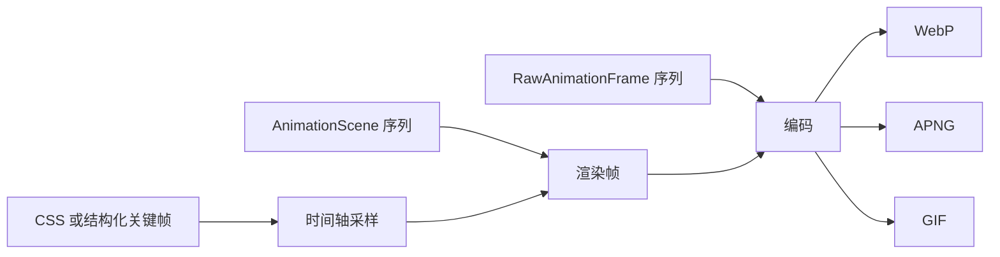

# 动画

动画 API 支持两种模型：在指定时刻对 CSS 或结构化关键帧采样，以及编码场景序列或原始帧。



## 时间轴采样 { #timeline-sampling }

`time_ms` 指定对 CSS 动画采样的时刻。关键帧可以来自样式表中的 `@keyframes` 规则，也可以
来自结构化的 `keyframes` 选项：

=== "CSS 关键帧"

    ```python
    from takumi_py import Renderer

    frame = Renderer().render_html(
        '<div class="box"></div>',
        stylesheets=[
            """
            @keyframes fade {
              from { opacity: 0; }
              to { opacity: 1; }
            }
            .box {
              width: 64px;
              height: 64px;
              background: black;
              animation: fade 1000ms both;
            }
            """
        ],
        width=64,
        height=64,
        time_ms=500,
    )
    ```

=== "结构化关键帧"

    ```python
    from takumi_py import Renderer

    frame = Renderer().render_node(
        {"type": "container", "className": "box"},
        stylesheets=[
            ".box { width: 64px; height: 64px; animation: fade 1000ms both; }",
        ],
        keyframes={
            "fade": {
                "from": {"opacity": 0},
                "to": {"opacity": 1},
            }
        },
        width=64,
        height=64,
        time_ms=500,
    )
    ```

`RenderOptions(keyframes=...)` 承载同样的结构化关键帧，因此可复用的选项值可以把动画
定义与 `time_ms` 放在一起。

## 场景序列 { #scene-sequences }

`render_animation` 接受一组 `AnimationScene`，每个场景是一个带时长的节点。`format`
参数选择 WebP、APNG 或 GIF，`fps` 控制时间轴的采样频率：

```python
from takumi_py import AnimationScene, Renderer

animation = Renderer().render_animation(
    [
        AnimationScene(
            {
                "type": "container",
                "style": {
                    "width": "100%",
                    "height": "100%",
                    "backgroundColor": "black",
                },
            },
            duration_ms=200,
        ),
        AnimationScene(
            {
                "type": "container",
                "style": {
                    "width": "100%",
                    "height": "100%",
                    "backgroundColor": "white",
                },
            },
            duration_ms=200,
        ),
    ],
    width=64,
    height=64,
    fps=20,
    format="webp",
)
```

`render_animation` 边渲染边把每一帧流式写入编码器，因此任何时刻只持有一帧原始图像，而
不是整段动画。如果只需要序列中的某一帧，调用 `render_sequence_at_time(scenes, time_ms)`，
它会以任意位图格式返回一张静态图片。

## 原始帧 { #raw-frames }

帧由其他途径生成时，例如来自 `format="raw"` 渲染或其他图像库，使用 `encode_frames` 和
`RawAnimationFrame`：

```python
from takumi_py import RawAnimationFrame, Renderer

black = bytes([0, 0, 0, 255] * 4)
white = bytes([255, 255, 255, 255] * 4)

gif = Renderer().encode_frames(
    [
        RawAnimationFrame(black, width=2, height=2, duration_ms=100),
        RawAnimationFrame(white, width=2, height=2, duration_ms=100),
    ],
    format="gif",
)
```

## 约定 { #contracts }

- 每个 `AnimationScene.duration_ms` 和 `RawAnimationFrame.duration_ms` 都必须是正整数。
  时长为零的场景或帧会抛出 `ValueError`，而不是被悄悄跳过。
- `fps` 必须为正，且不能超过所选格式的延迟精度：WebP 和 APNG 最高 90 fps，GIF 最高
  50 fps。`fps` 更高时，`render_animation` 会在渲染前抛出 `ValueError`。
- 提供 `webp_speed` 时，它必须是 0 到 6 的整数。
- 原始帧的尺寸必须为正，且恰好包含 `width * height * 4` 个 RGBA 字节。
- `loop_count` 设置重复次数；`None` 保留该格式的默认值。

!!! note "WebP 默认无损"

    既未指定 `quality` 也未指定 `lossless` 时，WebP 动画默认无损。`quality` 与
    `lossless=True` 互斥。

可运行示例见
[`examples/render_animation.py`](https://github.com/BalconyJH/takumi-py/blob/main/examples/render_animation.py)。
