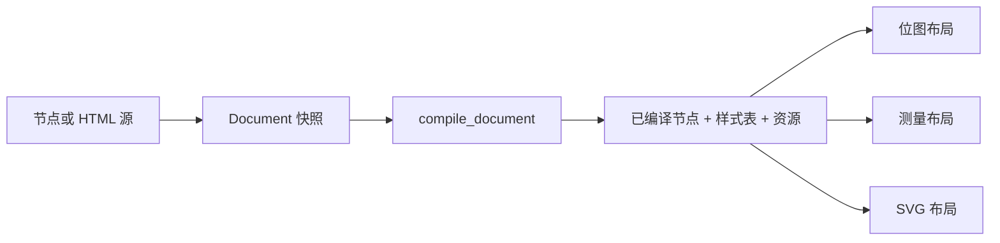

# 文档与可复用输出

!!! info "下一主版本预览"

    `Document`、`CompiledDocument`、`Fragment`、`ResourceSet`，以及新增的
    `Renderer.render`、`Renderer.measure` 和 `Renderer.render_svg` 入口，是当前代码检出
    中的下一主版本预览。这些 API 是增量能力：包元数据和版本保持不变，现有
    `render_*`、`measure_*` 和 `render_svg_*` API 继续兼容。

文档 API 把渲染输入与它拥有的资源组合在一起，再将编译与输出分开。同一内容需要输出
位图、进行测量并输出 SVG，尤其是图片字节需要随文档一起传递时，这种方式更合适。

这些 API 由原生 Python 包实现。它们不会启动 JavaScript 运行时、依赖 Node.js、加载
外部 sidecar，也不会获取远程资源。

## 流水线 { #pipeline }



`Document.from_node` 和 `Document.from_html` 会创建不可变的源快照。
`compile_document` 解析节点或 HTML，编译并合并样式表，然后返回包含以下内容的
`CompiledDocument`：

| 组成 | 用途 |
| --- | --- |
| `node` | 原生 `CompiledNode` |
| `stylesheets` | 零个或一个已合并的原生样式表 |
| `resources` | 不可变的 `ResourceSet` 快照 |

`Renderer.render`、`Renderer.measure` 和 `Renderer.render_svg` 接受 `Document` 或
`CompiledDocument`。传入原始 `Document` 时，该次调用会先编译它。需要复用编译结果时，
请先调用 `compile_document`。

!!! warning "只复用编译结果，不复用布局"

    `CompiledDocument` 拥有已解析的源和资源，不拥有预计算布局、绘制树或像素缓冲区。
    每次输出调用都会重新布局已编译节点。因此，相同已编译文档在布局选项、动画时间、
    媒体分辨率和位图缩放不同时，可能产生不同的几何或像素。

## 创建文档 { #create-a-document }

### 节点文档 { #node-documents }

`Document.from_node` 接受节点映射并创建快照。节点文档会严格编译 CSS，因此非法样式表
语法会抛出 `StyleSheetError`。

```python
from pathlib import Path

from takumi_py import (
    Document,
    Fragment,
    ImageResource,
    LayoutOptions,
    RasterOptions,
    Renderer,
    ResourceSet,
    compile_document,
)

logo = Fragment(
    {
        "type": "image",
        "src": "memory://logo",
        "width": 32,
        "height": 32,
    },
    ResourceSet(
        [
            ImageResource("memory://logo", Path("logo.svg").read_bytes()),
        ]
    ),
)

document = Document.from_node(
    {
        "type": "container",
        "className": "card",
        "children": [
            logo,
            {"type": "text", "text": "Reusable document"},
        ],
    },
    stylesheets=[
        ".card { padding: 24px; color: black; }",
    ],
)

compiled = compile_document(document)
renderer = Renderer()

png = renderer.render(
    compiled,
    layout=LayoutOptions(width=320, height=160),
    output=RasterOptions(scale=2),
)
```

样式表字符串按顺序应用。传给任一文档构造函数的结构化 `keyframes` 会在这些样式表之后
编译。文档快照会为可变的节点、样式表、关键帧和资源输入保留防御性副本。

### HTML 文档 { #html-documents }

`Document.from_html` 保存 HTML 字符串，以及显式提供的资源和样式表。原生解析器负责 HTML
结构和配置的样式预设；文档级 CSS 仍然需要显式提供。HTML 文档使用 Takumi 的容错 CSS
解析器，因为浏览器生成的样式表通常会包含渲染器不支持的声明。

```python
from pathlib import Path

from takumi_py import (
    Document,
    HtmlOptions,
    ImageResource,
    LayoutOptions,
    Renderer,
    compile_document,
)

document = Document.from_html(
    '<article class="story"><p>Read me</p></article>',
    resources=[
        ImageResource("memory://cover", Path("cover.webp").read_bytes()),
    ],
    stylesheets=[
        ".story { padding: 24px; }",
        "@media (min-width: 600px) { .story { padding: 48px; } }",
    ],
    html_options=HtmlOptions(presets="chromium"),
)

compiled = compile_document(document)
renderer = Renderer()

svg = renderer.render_svg(
    compiled,
    layout=LayoutOptions(width=640, height=360),
)
```

HTML 解析不会发现图片字节、Markdown、公式或外部样式表。请显式传入每个图片资源，并把
所有文档级 CSS 放入 `stylesheets`。

### Fragment 与资源 { #fragments-and-resources }

`Fragment` 把一个可复用节点值与 `ResourceSet` 组合在一起。创建 `Document` 时，它会遍历
节点树，在对应位置展开每个 fragment，对展开后的节点创建快照，并把 fragment 资源追加到
文档。同一个 fragment 可以重复出现，相同资源不会重复保存。

传给 `Document.from_node` 的 fragment 必须包含节点映射。泛型 `Fragment` 可以保存其他
值，但包含 `CompiledNode` 的 fragment 不能展开为源文档；已经编译的节点树应使用
compiled-node API。

`ResourceSet` 保持首次出现顺序并复制资源字节。`src`、字节和缓存模式完全相同的重复项会
合并。如果同一个 `src` 对应不同字节或不同缓存模式，构造资源集时抛出 `ResourceError`。

```python
from takumi_py import ImageResource, ResourceError, ResourceSet

try:
    resources = ResourceSet(
        [
            ImageResource("memory://logo", b"first image"),
            ImageResource("memory://logo", b"different image"),
        ]
    )
except ResourceError as error:
    print(error)
```

fragment 携带的资源与传给 `Document.from_node` 的资源共享同一个命名空间。组装后的文档中
只要任意位置发生冲突，就会报错，而不会采用最后出现的资源。

## 编译一次，为每种输出分别布局 { #compile-once }

对 `Document` 捕获的源和选项而言，编译结果是确定的。同一个 `CompiledDocument` 可以在多个
渲染器与多种输出之间复用。

```python
from takumi_py import Document, LayoutOptions, RasterOptions, Renderer, compile_document

compiled = compile_document(
    Document.from_node(
        {
            "type": "container",
            "style": {"width": "160px", "height": "80px", "backgroundColor": "black"},
        }
    )
)

renderer = Renderer()
layout = LayoutOptions(width=240, height=120)

png = renderer.render(compiled, layout=layout, output=RasterOptions(format="png"))
raw = renderer.render(compiled, layout=layout, output=RasterOptions(format="raw"))
measured = renderer.measure(compiled, layout=layout)
svg = renderer.render_svg(compiled, layout=layout)
```

上例每次调用都会独立布局内容。这是有意设计：测量始终使用设备像素比 1，SVG 使用
CSS 像素尺寸，位图输出则可能使用其他缩放比例。图片资源可通过文档获得，但解码后的图片
仍属于渲染器本地状态，并遵循各渲染器的资源缓存策略。

## 使用 CSS 像素布局 { #layout-in-css-pixels }

`LayoutOptions` 以 CSS 像素描述文档视口：

| 字段 | 默认值 | 含义 |
| --- | --- | --- |
| `width` | `1200` | 以 CSS 像素表示的画布宽度，或 `None` 表示推断 |
| `height` | `None` | 以 CSS 像素表示的画布高度，或 `None` 表示推断 |
| `font_size` | `16.0` | 用于 `rem` 和回退字体度量的根字号 |
| `time_ms` | `0` | 动画采样时间 |
| `font_families` | `None` | 首选回退字体族顺序 |
| `lang` | `None` | 用于字形整形和断行的 BCP-47 语言 |

显式尺寸必须是正的 32 位整数。`font_size` 必须是有限的正原生浮点数。`time_ms` 必须是
非负的 64 位有符号整数。

`render`、`measure` 和 `render_svg` 接收相同的布局尺寸。`width`、`height`、
`orientation` 和 `aspect-ratio` 等视口媒体查询使用实际 CSS 尺寸，包括下文说明的位图
取整影响。位图调用还会把
`RasterOptions.scale` 作为设备像素比，因此即使 `LayoutOptions` 不变，位图输出与测量或
SVG 之间的 `resolution` 媒体查询结果也可能不同。

## 位图输出与缩放 { #raster-output-and-scale }

`RasterOptions` 控制位图编码，对 `measure` 或 `render_svg` 没有影响。

| 字段 | 默认值 | 含义 |
| --- | --- | --- |
| `format` | `"png"` | `"png"`、`"jpeg"`、`"jpg"`、`"webp"`、`"ico"` 或 `"raw"` |
| `scale` | `1.0` | 每个 CSS 像素对应的输出像素数 |
| `quality` | `None` | 0 到 100 的有损编码质量 |
| `lossless` | `None` | 无损 WebP 编码 |
| `dithering` | `"none"` | 抖动模式 |
| `draw_debug_border` | `False` | 绘制布局调试边框 |

`scale` 会乘以显式 CSS 尺寸，用于选择输出画布。例如，1200×630 的 CSS 布局在缩放比例为 2
时生成 2400×1260 位图。推断维度仍保持推断状态，并会按最终内容尺寸缩放。

允许使用小数缩放比例。每个显式输出维度使用 `ceil(width * scale)` 和
`ceil(height * scale)` 向上取整；不要只根据输出画布断言精确的小数像素几何。缩放后的
维度超过原生 32 位上限时抛出 `ValueError`。

原生位图视口由取整后的画布与缩放比例还原。例如，宽度 41、缩放比例 1.5 会生成 62 个
输出像素，对应的实际 CSS 宽度约为 41.333。这会影响视口单位和断点附近的媒体查询匹配，
包括宽度、高度、宽高比和方向。需要在断点处与测量或 SVG 布局保持一致时，应选择能让
显式尺寸映射为整数输出像素的缩放比例。

```python
import struct

from takumi_py import Document, LayoutOptions, Renderer, RasterOptions, compile_document

compiled = compile_document(
    Document.from_node(
        {
            "type": "container",
            "style": {"width": "1200px", "height": "630px"},
        }
    )
)

png = Renderer().render(
    compiled,
    layout=LayoutOptions(width=1200, height=630),
    output=RasterOptions(format="png", scale=1.5),
)

assert struct.unpack(">II", png[16:24]) == (1800, 945)
```

## 旧版像素尺寸 { #legacy-pixel-sizing }

现有 API 继续受支持并保持当前语义。它们的 `width` 和 `height` 参数是输出像素尺寸；
`device_pixel_ratio` 会在这个固定位图中改变 CSS 视口和媒体分辨率。文档 API 反转了这个
轴：先由 `LayoutOptions` 设置 CSS 像素，再由 `RasterOptions.scale` 选择输出像素。

```python
from takumi_py import (
    Document,
    LayoutOptions,
    RasterOptions,
    Renderer,
    compile_document,
)

legacy = Renderer().render_html(
    "<div>Hello</div>",
    width=1200,
    height=630,
    device_pixel_ratio=2,
)

document = Document.from_node({"type": "text", "text": "Hello"})
new_api = Renderer().render(
    compile_document(document),
    layout=LayoutOptions(width=1200, height=630),
    output=RasterOptions(scale=2),
)
```

上面的旧版渲染仍生成 1200×630 的输出画布。文档渲染会生成 2400×1260 画布，因为
1200×630 在这里是 CSS 尺寸。调用方已经用输出像素表达尺寸时，请继续使用旧版方法；
不要静默转换它们。

## 校验与失败 { #validation-and-failures }

文档构造和编译会在能够解释问题的层抛出错误：

| 失败 | 异常 |
| --- | --- |
| 同一 `src` 的图片数据或缓存模式冲突 | `ResourceError` |
| 编译期间节点映射非法 | `NodeDecodeError` |
| HTML 非法或超出解析深度 | `HtmlParseError` |
| 严格模式的节点 CSS 或结构化关键帧非法 | `StyleSheetError` |
| 布局或输出数值选项非法 | `ValueError` |
| 渲染、图片解码或编码失败 | 原生渲染异常 |

传入 `CompiledDocument` 可以避免重新编译，但不会跳过布局期校验或输出编码检查。渲染器
仍会解析图片、选择字体、在请求的视口和缩放比例下计算媒体查询、执行布局并编码请求的
输出。

## API 参考 { #api-reference }

新增文档 API 的完整生成签名位于
[Renderer API 页面](../reference/api/renderer.md#document-apis)。现有签名也仍可在该页
查看。
