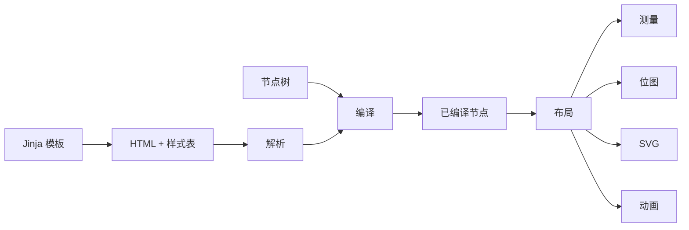

# 渲染模型

无论源数据以何种形式表示，`Renderer` 都遵循同一条流水线：



本页介绍所有输入共享的阶段：选择输入、编译输入和配置渲染。解析见
[HTML 与 CSS](html.md)，渲染产物见 [输出格式](output.md)。

## 选择输入 { #choose-an-input }

| 输入 | 入口 | 指南 |
| --- | --- | --- |
| 节点树 | `render_node`、`measure_node`、`render_svg_node` | [节点树](#node-trees) |
| HTML | `render_html`、`measure_html`、`render_svg_html` | [HTML 与 CSS](html.md) |
| Jinja 模板 | `render_template`、`render_svg_template`、`TemplateRenderer` | [Jinja 模板](templates.md) |
| 已编译节点 | `render_compiled`、`measure_compiled`、`render_svg_compiled` | [编译与复用](#compile-and-reuse) |
| 场景序列 | `render_animation`、`render_sequence_at_time` | [动画](animation.md) |

## 节点树 { #node-trees }

节点树是一个映射，其 `type` 为 `"container"`、`"text"` 或 `"image"`。样式使用驼峰
形式的 CSS 属性名，容器可以嵌套子节点：

```python
from takumi_py import Renderer

png = Renderer().render_node(
    {
        "type": "container",
        "style": {
            "width": "320px",
            "height": "160px",
            "display": "flex",
            "alignItems": "center",
            "justifyContent": "center",
            "backgroundColor": "white",
        },
        "children": [
            {"type": "text", "text": "Hello", "style": {"fontSize": "48px"}},
        ],
    },
    width=320,
    height=160,
)
```

每个节点还接受用于选择器的 `className`、`id`、`tagName` 和 `attributes`，承载
Tailwind 类名的 `tw`，以及 `dir` 和 `lang` 元数据。`TextNode`、`ImageNode` 和
`ContainerNode` 为类型检查器描述了这些结构。

向节点入口传入 `validate=True`，即可在映射进入原生解码器之前先用 Python 校验。校验
失败抛出 `NodeValidationError`；不校验时，格式错误的节点由解码器抛出
`NodeDecodeError`。

## 编译与复用 { #compile-and-reuse }

只渲染一次时，直接调用 `render_node` 或 `render_html`。同一内容需要反复渲染时，把
解析和样式表编译移出热路径：

```python
from takumi_py import Renderer

renderer = Renderer()
compiled = renderer.compile_node({"type": "text", "text": "Reusable"})
stylesheet = renderer.compile_stylesheet("span { font-size: 32px; }")

png = renderer.render_compiled(
    compiled,
    stylesheets=[stylesheet],
    width=320,
    height=160,
)
```

`compile_html` 返回 `CompiledHtml` 组合，而不是单独的 `CompiledNode`。把其中的节点和
样式表分别传给已编译 API，并在把文档级 CSS 加入样式表元组之前先编译它：

```python
from takumi_py import Renderer

renderer = Renderer()
compiled = renderer.compile_html('<div class="card">Reusable HTML</div>')
stylesheets = (
    *compiled.stylesheets,
    renderer.compile_stylesheet(".card { width: 320px; height: 160px; color: black; }"),
)

png = renderer.render_compiled(
    compiled.node,
    stylesheets=stylesheets,
    width=320,
    height=160,
)
```

不要把 `CompiledHtml` 包装本身传给 `render_compiled` 或 `measure_compiled`，这两个
方法只接受 `CompiledNode`。

## 渲染选项 { #render-options }

每项渲染设置都是一个关键字参数。`RenderOptions` 把同样的设置组合成一个可复用的值：

```python
from takumi_py import RenderOptions, Renderer

options = RenderOptions(
    width=None,
    height=None,
    format="raw",
    device_pixel_ratio=2.0,
    dithering="ordered-bayer",
)

raw = Renderer().render_node(
    {
        "type": "container",
        "style": {
            "width": "240px",
            "height": "120px",
            "backgroundColor": "white",
        },
    },
    options=options,
)
```

显式关键字参数会在该次调用中覆盖 `RenderOptions` 的同名字段，因此
`render_node(node, options=options, format="png")` 会保留 `options` 的其余字段。绑定
仍会拒绝相互矛盾的组合，例如有损 `quality` 与 `lossless=True` 同时出现。

## 视口 { #viewport }

默认视口为 1200×630。传入 `width=None` 或 `height=None` 可由布局推断该维度。需要多次
调用得到相同结果时，请固定两个维度。

## 参数约定 { #parameter-contracts }

原生边界会在渲染之前校验参数值：

| 参数 | 约定 |
| --- | --- |
| `width`、`height` | `None` 表示由布局推断，否则为正整数 |
| `font_size` | 大于零的有限数 |
| `device_pixel_ratio` | 大于零的有限数 |
| `time_ms` | 非负整数 |
| 渲染级 `lang` | `None` 或合法的 BCP-47 语言标签 |
| `quality` | 0 到 100 的整数 |
| `lossless` | 仅支持 WebP；`lossless=True` 不能与 `quality` 同时使用 |
| `dithering` | `"none"` 或 `"ordered-bayer"`；`"floyd-steinberg"` 是 `"ordered-bayer"` 的弃用别名 |

非法数值和相互矛盾的编码器选项会抛出 `ValueError`。绑定无法识别的格式名称会抛出
[异常参考](../reference/exceptions.md) 中描述的格式或动画异常。

可运行示例见
[`examples/render_node.py`](https://github.com/BalconyJH/takumi-py/blob/main/examples/render_node.py)
和
[`examples/render_options_measure.py`](https://github.com/BalconyJH/takumi-py/blob/main/examples/render_options_measure.py)。
