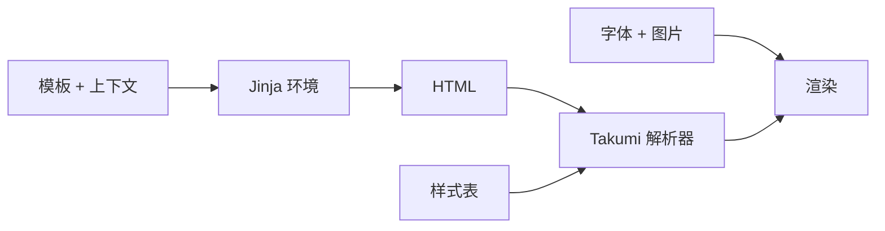

# Jinja 模板

`TemplateRenderer` 持有一个基于文件系统的 Jinja 环境，并把渲染出的 HTML 交给 Takumi
解析器。

```python
from takumi_py import Renderer, TemplateRenderer


def uppercase(value: str) -> str:
    return value.upper()


configured_renderer = Renderer()
renderer = TemplateRenderer(
    "templates",
    filters={"uppercase": uppercase},
    renderer=configured_renderer,
)

png = renderer.render(
    "card.html.jinja",
    {"title": "takumi-py"},
    stylesheets=[
        ".card { width: 1200px; height: 630px; color: white; background: #111827; }",
    ],
    width=1200,
    height=630,
)
```

模板中可以直接使用 `{{ title | uppercase }}`。调用方只需要 HTML 字符串而非图片输出时，
`render_template_to_html` 辅助函数接受同样的 `filters` 映射。

## 注入完整的 Jinja 环境 { #inject-a-complete-jinja-environment }

基于文件系统的环境只是便捷的默认值，并不限制可用的 Jinja 能力。应用需要其他加载器、
全局变量、测试、扩展、未定义值策略、字节码缓存或其他原生 Jinja 配置时，注入一个现有的
`jinja2.Environment`：

```python
from jinja2 import Environment, PackageLoader, StrictUndefined, select_autoescape

from takumi_py import TemplateRenderer


environment = Environment(
    loader=PackageLoader("my_app", "templates"),
    autoescape=select_autoescape(("html", "xml", "jinja")),
    undefined=StrictUndefined,
)
environment.globals["product_name"] = "My App"
environment.tests["featured"] = lambda item: item.featured

renderer = TemplateRenderer(
    environment=environment,
    filters={"currency": lambda value: f"${value:,.2f}"},
)
```

`renderer.environment` 就是注入的那个实例。`filters` 会在加载第一个模板之前更新到该
实例上。`render_template_to_html` 同样接受 `environment=...`。在这两个 API 中，
`template_dir` 与 `environment` 互斥，以免一个模板加载来源悄悄遮蔽另一个。

## 注入已配置的渲染器 { #inject-a-configured-renderer }

模板需要共享已注册的字体或其他由渲染器持有的状态时，把现有的 `Renderer` 传给
`TemplateRenderer`。先配置渲染器，再注入同一个实例：

```python
from pathlib import Path

from takumi_py import FontResource, Renderer, TemplateRenderer


def uppercase(value: str) -> str:
    return value.upper()


configured_renderer = Renderer(load_default_fonts=False)
families = configured_renderer.register_font(
    FontResource(
        Path("Inter-Regular.woff2").read_bytes(),
        name="Inter",
        generic_family="sans-serif",
    )
)
renderer = TemplateRenderer(
    "templates",
    filters={"uppercase": uppercase},
    renderer=configured_renderer,
)
png = renderer.render(
    "card.html.jinja",
    {"title": "takumi-py"},
    stylesheets=[".card { width: 1200px; height: 630px; }"],
    font_families=families,
    width=1200,
    height=630,
)
```

## 职责边界 { #responsibility-boundaries }



- 在首次渲染之前配置过滤器、全局变量、测试和扩展。模板加载之后再修改环境，Jinja 不保证
  行为可预测。
- 模板只负责生成 HTML。图片通过渲染输入提供。按上文所示在注入的渲染器上注册自定义字体，
  并遵循 [资源指南](resources.md)。
- 把 CSS 放在显式的 `stylesheets` 输入中，避免模板层掌管渲染配置。
- 对 HTML、XML 和 Jinja 文件默认启用 Jinja 自动转义。调用方提供的环境保留其自身的
  自动转义策略。

!!! caution "自定义过滤器会执行应用代码"

    请把过滤器函数和模板目录视为可信的应用输入。自动转义保护的是插值后的标记，并不会把
    Python 过滤器代码放进沙箱。

可运行示例见
[`examples/render_template.py`](https://github.com/BalconyJH/takumi-py/blob/main/examples/render_template.py)
及其模板
[`card.html.jinja`](https://github.com/BalconyJH/takumi-py/blob/main/examples/templates/card.html.jinja)。
