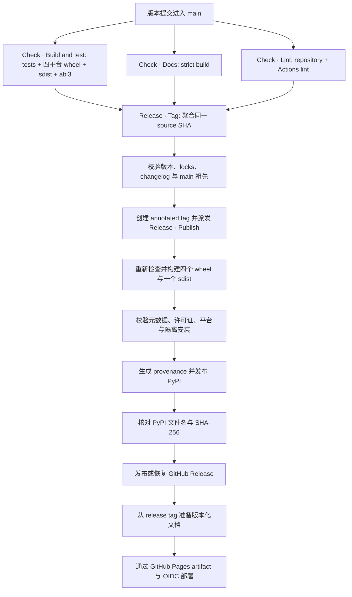

# 发布

正常发布由 `main` 上的版本变化驱动。维护者无需手工构建制品、创建标签或部署文档；
自动化只会处理同时满足版本契约和同一提交门禁的版本。

## 准备发布提交 { #prepare-the-release-commit }

发布提交必须同时满足以下契约：

- `pyproject.toml` 使用正式版本 `X.Y.Z`，或其预发布版本 `X.Y.ZaN`、`X.Y.ZbN`、
  `X.Y.ZrcN`；根 `Cargo.toml` 使用对应的 SemVer 写法，例如 `0.4.0rc1` 对应
  `0.4.0-rc.1`。
- 相对 `main` 第一父提交，项目版本严格递增。
- `uv.lock` 与 `Cargo.lock` 已更新且能通过 locked 检查。
- `CHANGELOG.md` 包含该版本带日期的章节，以及 `make changelog` 生成的提交列表。
- `make check`、`make docs-build` 和全部 Prek hook 均通过。

用一个目标完成全部准备：

```bash
make release VERSION=0.4.0
```

它通过 `.github/scripts/set-version.py` 设置 `pyproject.toml`、`Cargo.toml` 和两个锁文件中
的版本，用 `make changelog` 写入 changelog 条目，再用
`.github/scripts/validate-release.py --version` 检查结果，也就是 `Release · Tag` 创建标签前
运行的检查。审阅 diff 后将其作为发布提交提交。

### Changelog 条目 { #changelog-entry }

在变更合入的过程中，按 Keep a Changelog 的分节把面向用户的说明整理到 `CHANGELOG.md` 的
`## [Unreleased]` 下。`make changelog` 会把它们变成发布条目：

- 把 `[Unreleased]` 标注为项目版本和日期，并在其上方新开一个空的 `[Unreleased]`。
- 追加一个 **Commits** 列表，由 git-changelog 根据上一个标签以来的约定式提交生成：先列出
  破坏性变更，再按提交类型分组，每个提交都以短哈希链接。
- 条目末尾附上完整 diff 的链接，以及一行 **Contributors**，@ 提及所有作者、共同作者和
  提交者，GitHub 自身的合并提交者除外。

登录名取自 GitHub noreply 邮箱；其他邮箱通过 `gh api` 查询，因此运行该目标前请先完成
`gh` 认证。向 `.github/scripts/changelog.py release` 传入 `--offline` 时，这些人会改为
按名字列出。用 `make changelog-preview VERSION=0.3.0` 预览条目，必要时编辑整理过的部分，
再与版本号变更一起提交。

发布工作流会把该章节原样发布为 GitHub Release 的说明。请用 merge commit 合并发布用的
pull request：squash 或 rebase 合并会改写条目所链接的提交哈希。

提交合并到 `main` 后，`Check · Build and test`、`Check · Docs`、`Check · Lint` 会分别验证
同一提交。`Release · Tag` 等待三个工作流全部成功，确认版本、锁文件、changelog 和 `main`
祖先关系后，为该提交创建 annotated `v0.3.0` 标签，并且仅派发一次 `Release · Publish`。

!!! note "普通发布不再手工创建标签"

    自动标签是精确提交门禁的一部分。手工标签会跳过门禁聚合，只应用于管理员明确判断过的
    异常恢复；正常发布不要执行 `git tag` 或直接运行 `Release · Publish`。

### 预发布版本 { #prereleases }

alpha、beta 或 release candidate，例如 `make release VERSION=0.4.0rc1`，与正式版本走同一条
链路，仅有三点不同：

- PyPI 只会在 `pip install --pre` 或精确指定版本时提供它。
- 它的 GitHub Release 标记为 prerelease，因此永远不会成为 Latest。
- 它的文档加入版本选择器，但不会移动 `latest` 或站点默认版本。

正式版本的条目只会列出最后一个预发布标签之后的提交。若正式版本的说明需要覆盖整个周期，
请把各预发布版本整理过的说明复制到 `[Unreleased]` 中。

## 自动发布链路 { #automatic-release-pipeline }



发布构建包含 Linux x86_64、Linux aarch64、macOS arm64、Windows x64 四个
`cp311-abi3` wheel 和一个 sdist。验证层会：

1. 检查完整制品集合、包元数据、许可证、ABI/平台标签及内置字体边界。
2. 在仓库外的临时虚拟环境安装并执行渲染 smoke，避免意外导入 checkout。
3. 从 sdist 重新构建 wheel，并对重建结果执行同样的隔离 smoke。
4. 对最终上传文件生成 GitHub build provenance。
5. 通过 Trusted Publishing 上传 PyPI；重跑时允许跳过已存在文件，但随后必须与
   PyPI JSON 中的完整文件集合和 SHA-256 完全一致。
6. 仅在 PyPI 核验成功后发布 GitHub Release，并以该版本的 `CHANGELOG.md` 章节作为
   发布说明，预发布版本会标记为 prerelease；现有已发布 Release 只允许摘要一致的幂等重跑，现有草稿可以用本次已验证
   制品恢复，并换用 changelog 中的说明。
7. 从同一个 release tag 通过运行 mike 的 `.github/scripts/deploy-docs.py` 更新两种语言
   的文档：英文位于站点根目录，简体中文位于 `zh/` 前缀下，各自维护 `versions.json`。
   早于中文站点的标签只部署英文。只有不旧于所有已发布正式版本的正式发布才能移动
   `latest`，预发布版本从不移动它，并对作为版本状态存储的 `gh-pages` 并发写入进行有限重试。
8. 从当前的 `gh-pages` 导出完整静态树，上传标准 `github-pages` artifact，并通过
   OIDC 部署到受保护的 `github-pages` environment。

## 文档预览 { #documentation-preview }

`Preview · Docs` 把 `main` 发布为 `dev` 文档版本。每次 `main` 上的推送使 `Check · Docs`
成功运行之后，它会用 `.github/scripts/deploy-docs.py dev` 以两种语言构建该提交，并部署
GitHub Pages，因此 `main` 上的文档变更几分钟内即可上线。

- `dev (main)` 位于版本选择器的最上方、各发布版本之上，地址为 `/takumi-py/dev/` 和
  `/takumi-py/zh/dev/`，页面顶部的横幅会标明其内容尚未发布。`latest` 和站点根目录仍指向最新发布版本；尚无发布版本的语言在
  首次发布之前，其站点根目录会打开 `dev`。
- 较新提交的预览会取消仍在运行的旧预览。
- 发布与预览的 Pages 部署共用 `github-pages` 并发组，并且每次部署时都导出 `gh-pages`
  的最新状态，因此谁也不会丢失对方的版本。

本地检查发布物时使用：

```bash
make build-artifacts
```

该目标会构建当前平台 wheel 与 sdist、运行 Twine 元数据检查，并在隔离环境中验证
wheel 以及 sdist 重建路径。`DIST_SMOKE_PYTHON` 可指定 smoke 使用的 Python 版本。

## 外部仓库设置 { #external-repository-settings }

仓库文件无法承载以下控制。它们在 GitHub 与 PyPI 上配置，管理员需保持如下状态：

- `Protect main` ruleset 禁止强制推送和删除 `main`。直接推送仍然允许，因此三个 Check
  工作流把关的是发布标签，而不是推送本身。
- PyPI Trusted Publishing 所信任的 `release` environment 只允许 `main`（用于恢复运行）和
  `v*` 标签部署。PyPI Trusted Publisher 绑定到 owner `BalconyJH`、repository `takumi-py`、
  workflow `publish.yml` 和 environment `release`。
- GitHub Pages Source 为 `GitHub Actions`，`github-pages` environment 只允许 `main`
  （用于 dev 预览）和 `v*` 标签部署。
- GitHub Release 不可变。工作流在 Release 仍为草稿时上传制品，对已发布的 Release 只做
  摘要核验。
- Actions 的 `GITHUB_TOKEN` 可按工作流声明获得写权限；若将来保护发布标签，需要为
  `Release · Tag` 配置受控 bypass。
- 已启用 secret scanning 与 push protection、Dependabot 警报与安全更新，以及私密漏洞报告，
  `SECURITY.md` 会引导报告者使用后者。
- Dependabot 每周为 GitHub Actions、uv 和 Cargo 提交分组更新，并通过相同门禁；被精确
  固定的 ty 与 Zensical 各自单独提交 pull request。

## 故障恢复 { #failure-recovery }

=== "门禁失败，尚未创建标签"

    修复问题并合并到 `main`。因为修复提交的版本可能与父提交相同，自动检测不会再次
    把它视为版本变化；此时从当前 `main` 手工运行 `Release · Tag`，传入
    当前完整 40 位 `source_sha`。恢复模式只接受当前 `main` 且仍会要求三个精确提交
    工作流全部成功。

=== "标签存在，但 Publish 未成功"

    从匹配标签或默认分支手工运行 `Release · Publish`，传入相同 `release_tag`。不要创建替代标签，
    也不要改写标签指向。

=== "PyPI 已经接收部分或全部文件"

    重跑同一标签的 `Release · Publish`。上传步骤使用 `skip-existing`，之后的摘要核验会确认已存在
    文件是否就是本次构建结果；缺失文件会等待 PyPI 元数据收敛，摘要不同则立即失败。

=== "GitHub Release 或文档部署失败"

    再次运行同一标签的 `Release · Publish`。已发布 Release 只有在文件集合与摘要完全一致时才被
    复用；草稿可从已验证制品恢复。文档准备会重新读取远端 `gh-pages` 并重试冲突，
    随后的 Pages deployment 会重新使用同一次运行上传的静态 artifact。

!!! danger "不要改写已经发布的制品"

    PyPI 文件、已发布 GitHub Release、release tag 都是不可变输入。任何摘要不一致都应
    停止发布并调查来源，而不是 force push、替换版本或覆盖已发布文件。
